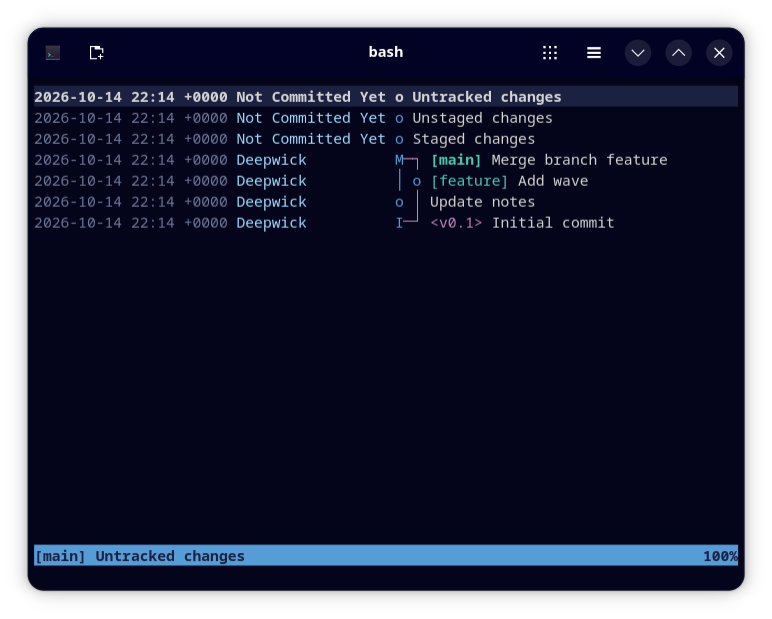

# Deepwick for tig

Deepwick colors for [tig](https://jonas.github.io/tig/).

> Deepwick is an unofficial theme derived from
> [Polywick Blue](https://vscode.polywickstudio.net) by Polywick Studio (MIT).
> Not affiliated with Polywick Studio.



## Install

```sh
mkdir -p ~/.config/tig
cp deepwick.tigrc ~/.config/tig/
```

Then add to your tig config (`~/.config/tig/config` or `~/.tigrc`):

```
source ~/.config/tig/deepwick.tigrc
```

tig does not expand `$VARIABLES` in `source` and resolves relative paths from
the current directory, so use the `~/` path.

## Notes

- tig supports only the 256 terminal colors, not 24-bit hex colors, so this
  theme uses ANSI color slots. It looks right with a Deepwick terminal theme
  ([Ptyxis](https://github.com/deepwick/ptyxis),
  [Konsole](https://github.com/deepwick/konsole),
  [Alacritty](https://github.com/deepwick/alacritty),
  [Ghostty](https://github.com/deepwick/ghostty)).
- Gold has no ANSI slot, so commit IDs are Yellow; dates are Muted instead of
  Comment. Authors Light Blue, branches Teal, tags Magenta.
- Untracked files Teal, unstaged changes Blue, staged changes Green.
- tig has no italic.

Tested with tig 2.6.1.

## License

MIT. See [LICENSE](LICENSE).
